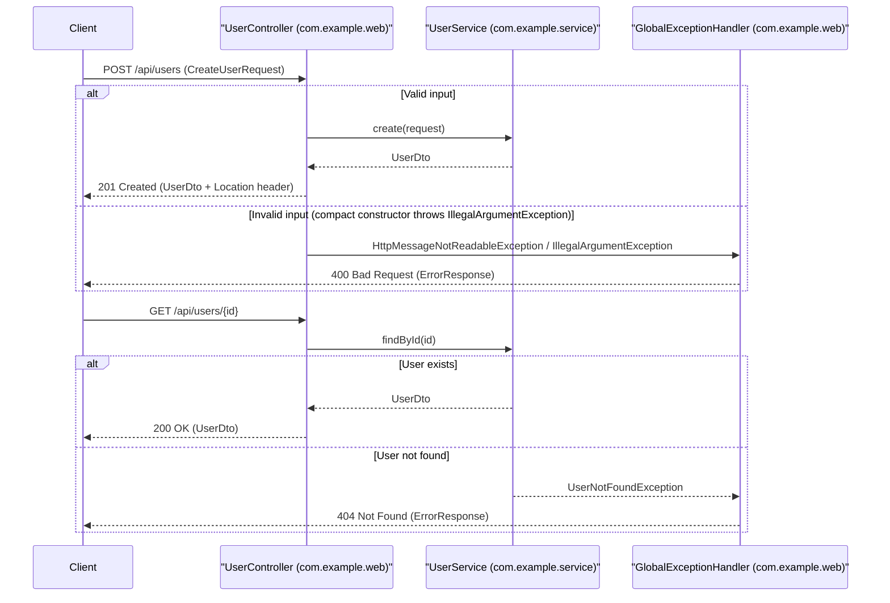

# Requirements

### Overview & Goals
Build a clean, small user-management REST API in this Spring Boot project following `.junie/AGENTS.md` and `.junie/guidelines.md`. The API will support listing all users, retrieving a user by ID, and creating a new user with input validation and normalization, backed by clear error handling and `MockMvc` + AssertJ tests.

### Scope
#### In Scope
- Upgrade `build.gradle.kts` to the latest stable Spring Boot 4 release (`4.1.2`), Java 25 toolchain, and Spring Boot 4's modular web/test starters (`spring-boot-starter-webmvc` and `spring-boot-starter-webmvc-test`), providing JUnit 6 and AssertJ.
- `GET /api/users`: Return all users as a JSON array of DTO records (`200 OK`).
- `GET /api/users/{id}`: Return a single user DTO record (`200 OK`) or a structured `404 Not Found` error response if the user does not exist.
- `POST /api/users`: Validate and normalize input (`name` and `email`), create a new user, and return `201 Created` (with `Location` header and created user DTO) or `400 Bad Request` on invalid input.
- Java `record` DTOs using compact constructors for validation and normalization (`trim()`, email format check).
- Service layer in `com.example.service` and controller + exception handling in `com.example.web`.
- Unit and `MockMvc` tests using JUnit 6 and AssertJ (`assertThat`) for both happy paths and 4xx failure paths.

#### Out of Scope
- External database / JPA persistence (an in-memory thread-safe store keeps the implementation small and self-contained without adding unrequested dependencies).
- Authentication, authorization, pagination, or `PUT`/`DELETE` endpoints.

### User Stories
- **As an API client**, I want to call `GET /api/users` so that I can retrieve the list of all registered users.
- **As an API client**, I want to call `GET /api/users/{id}` so that I can inspect a specific user or receive a clear `404 Not Found` response when the ID does not exist.
- **As an API client**, I want to call `POST /api/users` with a name and email so that a validated, normalized user is created and returned, or a clear `400 Bad Request` error is returned when input is invalid.

### Functional Requirements
1. **List Users (`GET /api/users`)**
   - Returns HTTP `200 OK` with `Content-Type: application/json` and a JSON list of `UserDto` records.
2. **Get User by ID (`GET /api/users/{id}`)**
   - Returns HTTP `200 OK` with the matching `UserDto` when found.
   - Returns HTTP `404 Not Found` with a structured JSON `ErrorResponse` when no user exists for `{id}`.
3. **Create User (`POST /api/users`)**
   - Accepts a JSON body mapped to `CreateUserRequest(String name, String email)`.
   - Compact constructor trims whitespace on `name` and `email` (and normalizes `email` to lowercase) and validates that `name` is non-blank and `email` is non-blank and contains a valid email format.
   - Returns HTTP `201 Created`, sets `Location: /api/users/{id}`, and returns the created `UserDto`.
   - Returns HTTP `400 Bad Request` with a structured JSON `ErrorResponse` if validation fails or the request body is malformed.

# Technical Design

### Current Implementation
- **Build & Dependencies (`build.gradle.kts`)**: Currently configured with Spring Boot `3.5.5` and Java 21 toolchain (`spring-boot-starter-web`, `spring-boot-starter-test`, `assertj-core:3.26.3`), with Gradle `9.6.0` in `gradle-wrapper.properties`. We will upgrade `build.gradle.kts` to the latest stable Spring Boot 4 release (`4.1.2`) and Java 25 toolchain (aligning with `.junie/AGENTS.md`: Java 25 and JUnit 6 + AssertJ), using `spring-boot-starter-webmvc` and `spring-boot-starter-webmvc-test`. Note that `spring-boot-starter-validation` is not on the classpath, which aligns directly with the guideline: *"Return DTO **records**; compact constructors for validation/normalization."*
- **Existing Code**:
  - `src/main/java/com/example/LabAApplication.java`: Standard `@SpringBootApplication` entry point.
  - `src/main/java/com/example/web/.gitkeep`: Empty controller package placeholder.
  - `src/test/java/com/example/LabAApplicationTests.java`: Baseline `@SpringBootTest` context load test.

### Key Decisions
1. **Upgrade to Spring Boot 4 (`4.1.2`) & Java 25**:
   - *Choice*: Upgrade `org.springframework.boot` plugin in `build.gradle.kts` to `4.1.2` (latest stable 4.x release on Maven Central), set the Java toolchain to `JavaLanguageVersion.of(25)`, and include `spring-boot-starter-webmvc` and `spring-boot-starter-webmvc-test` (which provides `@WebMvcTest` under `org.springframework.boot.webmvc.test.autoconfigure.WebMvcTest`, `MockMvc` / `MockMvcTester`, JUnit 6, and Jackson 3 `tools.jackson.databind.ObjectMapper`).
   - *Rationale*: Requested by the user and brings `build.gradle.kts` into full alignment with `.junie/AGENTS.md` (Java 25, JUnit 6 + AssertJ) and Gradle 9.6.0.
2. **Validation via Record Compact Constructors**:
   - *Choice*: Perform validation and normalization directly inside the `CreateUserRequest` (and `UserDto`) compact constructors, throwing `IllegalArgumentException` with clear messages when invariants are violated.
   - *Rationale*: Explicitly mandated by `.junie/AGENTS.md` (*"Return DTO records; compact constructors for validation/normalization"*), works natively in Java without adding extra starter dependencies, and guarantees domain objects are always valid upon construction.
3. **In-Memory Storage in `UserService`**:
   - *Choice*: Use `ConcurrentHashMap<Long, UserDto>` and `AtomicLong` inside `com.example.service.UserService`.
   - *Rationale*: Keeps the implementation small, thread-safe, and fast while cleanly separating web and service responsibilities.
4. **Centralized Exception Handling (`@RestControllerAdvice`)**:
   - *Choice*: Map `UserNotFoundException` to HTTP `404 Not Found` and `IllegalArgumentException` / `HttpMessageNotReadableException` (which wraps `IllegalArgumentException` thrown by Jackson during record instantiation) to HTTP `400 Bad Request` returning an `ErrorResponse` DTO record.
   - *Rationale*: When Jackson deserializes a JSON request into `CreateUserRequest`, an `IllegalArgumentException` thrown in the record's compact constructor is either surfaced directly or wrapped in `HttpMessageNotReadableException` (`ValueInstantiationException`). Handling both in `GlobalExceptionHandler` ensures consistent `400 Bad Request` responses with the original validation message.

### Data Models / Contracts
- **`com.example.web.UserDto`**
  ```java
  public record UserDto(Long id, String name, String email) {
      public UserDto {
          if (id == null || id <= 0) {
              throw new IllegalArgumentException("User id must be positive");
          }
          if (name == null || name.isBlank()) {
              throw new IllegalArgumentException("Name must not be blank");
          }
          if (email == null || email.isBlank() || !email.contains("@")) {
              throw new IllegalArgumentException("Email must be a valid address");
          }
          name = name.trim();
          email = email.trim().toLowerCase();
      }
  }
  ```
- **`com.example.web.CreateUserRequest`**
  ```java
  public record CreateUserRequest(String name, String email) {
      public CreateUserRequest {
          if (name == null || name.isBlank()) {
              throw new IllegalArgumentException("Name must not be blank");
          }
          if (email == null || email.isBlank() || !email.contains("@")) {
              throw new IllegalArgumentException("Email must be a valid address");
          }
          name = name.trim();
          email = email.trim().toLowerCase();
      }
  }
  ```
- **`com.example.web.ErrorResponse`**
  ```java
  public record ErrorResponse(int status, String error, String message, String path, Instant timestamp) {
      public ErrorResponse {
          if (message == null || message.isBlank()) {
              message = "Unexpected error";
          }
          if (timestamp == null) {
              timestamp = Instant.now();
          }
      }
  }
  ```
- **`com.example.service.UserNotFoundException`**
  ```java
  public class UserNotFoundException extends RuntimeException {
      public UserNotFoundException(Long id) {
          super("User not found with id: " + id);
      }
  }
  ```
- **`com.example.service.UserService`**
  - `List<UserDto> findAll()`
  - `UserDto findById(Long id)` (throws `UserNotFoundException` if missing)
  - `UserDto create(CreateUserRequest request)`

### File Structure
```text
build.gradle.kts                         (modified: Spring Boot 4.1.2, Java 25, spring-boot-starter-webmvc / spring-boot-starter-webmvc-test)
src/main/java/com/example/
├── LabAApplication.java
├── service/
│   ├── UserNotFoundException.java   (added)
│   └── UserService.java             (added)
└── web/
    ├── CreateUserRequest.java       (added)
    ├── ErrorResponse.java           (added)
    ├── GlobalExceptionHandler.java  (added)
    ├── UserController.java          (added)
    └── UserDto.java                 (added)

src/test/java/com/example/
├── LabAApplicationTests.java
├── service/
│   └── UserServiceTest.java         (added)
└── web/
    └── UserControllerTest.java      (added)
```

### Architecture Diagram


### Risks & Tradeoffs
- **Spring Boot 4 Modular Starters & Package Moves**: In Spring Boot 4, `@WebMvcTest` moved to `org.springframework.boot.webmvc.test.autoconfigure.WebMvcTest` (provided by `spring-boot-starter-webmvc-test`) and Jackson 3 uses `tools.jackson.databind`. Including `spring-boot-starter-webmvc` and `spring-boot-starter-webmvc-test` in `build.gradle.kts` ensures all MVC test slices and JSON serialization utilities work seamlessly.
- **Jackson Deserialization Wrapping**: When a record's compact constructor throws `IllegalArgumentException` during `@RequestBody` deserialization, Jackson wraps it inside `HttpMessageNotReadableException` with `getMostSpecificCause()` being the `IllegalArgumentException`. `GlobalExceptionHandler` will inspect the root cause so the exact validation message (e.g., `"Name must not be blank"`) is preserved in the `400 Bad Request` response body.
- **In-Memory State**: Storing users in memory means data resets on application restart, which is an intentional tradeoff to keep the lab implementation small and focused on REST, DTO records, validation, and testing.

# Testing

### Validation Approach
Run `./gradlew test` to execute all JUnit tests and verify every endpoint, DTO compact constructor, and error handler using `MockMvc` and AssertJ (`assertThat`).

### Key Scenarios
1. **`GET /api/users` (Empty and Populated)**
   - Returns `200 OK` and an empty JSON array `[]` when no users exist, or the list of users when populated.
   - Assert response status, JSON structure, and deserialized `UserDto` contents using AssertJ `assertThat(...)`.
2. **`GET /api/users/{id}` (Found)**
   - Returns `200 OK` with matching `id`, `name`, and `email`.
3. **`POST /api/users` (Valid & Normalized Input)**
   - Submitting `{"name": "  Alice Smith  ", "email": "  ALICE@Example.com "}` returns `201 Created`, `Location: /api/users/1`, and normalized fields (`"Alice Smith"`, `"alice@example.com"`).

### Edge Cases & Negative/4xx Tests
1. **`GET /api/users/{id}` (Not Found -> `404 Not Found`)**
   - Requesting a non-existent ID (e.g., `/api/users/999`) returns `404 Not Found` and an `ErrorResponse` body containing `"User not found with id: 999"`.
2. **`POST /api/users` with Blank Name (`400 Bad Request`)**
   - Submitting `{"name": "   ", "email": "alice@example.com"}` returns `400 Bad Request` with error message `"Name must not be blank"`.
3. **`POST /api/users` with Invalid Email (`400 Bad Request`)**
   - Submitting `{"name": "Alice", "email": "not-an-email"}` returns `400 Bad Request` with error message `"Email must be a valid address"`.
4. **`POST /api/users` with Malformed JSON (`400 Bad Request`)**
   - Submitting invalid JSON syntax returns `400 Bad Request` with a clear error message.

### Test Changes
- Add `src/test/java/com/example/service/UserServiceTest.java`: Unit tests for `CreateUserRequest`, `UserDto`, and `UserService` using AssertJ (`assertThat`, `assertThatThrownBy`).
- Add `src/test/java/com/example/web/UserControllerTest.java`: Web slice tests using `@WebMvcTest(UserController.class)` (or `MockMvc` with `ObjectMapper`) and AssertJ `assertThat(...)` assertions on status codes, headers, and response payloads.

# Delivery Steps

### ✓ Step 1: Upgrade to Spring Boot 4.1.2 and implement DTO records, exceptions, and UserService
The build is upgraded to Spring Boot 4.1.2 with Java 25, and domain DTO records, custom exceptions, and the in-memory user management service are implemented with validation and normalization.

- Update `build.gradle.kts` to use Spring Boot `4.1.2`, Java 25 toolchain (`JavaLanguageVersion.of(25)`), `spring-boot-starter-webmvc`, and `spring-boot-starter-webmvc-test` (which brings JUnit 6, AssertJ, and `@WebMvcTest`).
- Create `UserDto` (`record UserDto(Long id, String name, String email)`) and `CreateUserRequest` (`record CreateUserRequest(String name, String email)`) in `com.example.web` using compact constructors to normalize (`trim()`, lowercase email) and validate non-blank `name` and valid `email` format, throwing `IllegalArgumentException` on invalid input.
- Create `UserNotFoundException` in `com.example.service` to signal missing user records by ID.
- Implement `UserService` in `com.example.service` using thread-safe in-memory storage (`ConcurrentHashMap<Long, UserDto>` and `AtomicLong` ID sequence) with small, intention-revealing methods: `findAll()`, `findById(Long id)`, and `create(CreateUserRequest request)`.
- Add unit tests in `src/test/java/com/example/service/UserServiceTest.java` using JUnit 6 and AssertJ (`assertThat`, `assertThatThrownBy`) to verify compact constructor validation/normalization and service behavior.

### ✓ Step 2: Implement UserController, GlobalExceptionHandler, and MockMvc tests
REST endpoints under `/api/users` and structured error handling are exposed and verified with comprehensive `MockMvc` + AssertJ tests.

- Implement `UserController` in `com.example.web` mapped to `/api/users` with `GET /api/users`, `GET /api/users/{id}`, and `POST /api/users` (returning `201 Created` with `Location` header `/api/users/{id}` and the created `UserDto`).
- Implement `GlobalExceptionHandler` (`@RestControllerAdvice`) in `com.example.web` with an `ErrorResponse` record (or `ProblemDetail`) handling `UserNotFoundException` (`404 Not Found`), `IllegalArgumentException` and `HttpMessageNotReadableException` (`400 Bad Request` with clear error details).
- Add `UserControllerTest` in `src/test/java/com/example/web/UserControllerTest.java` using Spring Boot 4's `@WebMvcTest(UserController.class)` (`org.springframework.boot.webmvc.test.autoconfigure.WebMvcTest`), `@MockitoBean`, `MockMvc`, and AssertJ (`assertThat`) covering both success cases (`200 OK`, `201 Created`) and negative/4xx cases (`404 Not Found` for unknown user ID, `400 Bad Request` for blank name, invalid email, or malformed JSON).
- Run `./gradlew test` to verify all unit and web slice tests pass without errors.

### ✓ Step 3: Migrate request validation to Jakarta Bean Validation
Request validation uses Jakarta Bean Validation (`spring-boot-starter-validation`) with `@NotBlank`, `@Email`, and `@Valid`, while record compact constructors handle input normalization (`trim()` and lowercase email).

- Add `implementation("org.springframework.boot:spring-boot-starter-validation")` to `build.gradle.kts`.
- Update `CreateUserRequest` to use `@NotBlank` and `@Email` constraints and keep its compact constructor focused on normalizing `name` and `email`.
- Annotate `@Valid @RequestBody CreateUserRequest request` in `UserController.createUser`.
- Add `@ExceptionHandler(MethodArgumentNotValidException.class)` in `GlobalExceptionHandler` to return `400 Bad Request` with validation error messages.
- Update `UserServiceTest` and `UserControllerTest` and run `./gradlew test` to verify all tests pass.