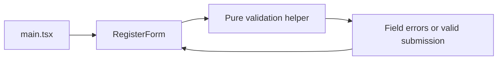

# Requirements

### Outcome
Replace the bare form with a responsive registration card: clear heading, stacked fields, consistent spacing, readable help text, prominent submit button, and visible focus/error/success states.

### Behavior
- Require a valid email; trim surrounding email whitespace.
- Require passwords of at least 8 characters, including a number and a non-whitespace special character. Do not trim passwords.
- Require matching confirmation and acceptance of terms.
- Show field-specific errors on submission, focus the first invalid control, and revalidate corrections after the first submission attempt.
- Display an announced success message only after valid submission; clear stale success when values change.
- Preserve native keyboard interactions, explicit labels, and sensible tab order.

### Scope
Keep this a client-side lab demonstration, not actual account creation. No backend, persistence, form library, password-strength meter, or fabricated terms link. Wait for approval before implementation.

# Technical Design

### Existing approach
`src/components/RegisterForm.tsx` uses local React state and a single error string. `src/main.tsx` mounts it directly. Jest uses `ts-jest`, `jsdom`, and `jest-dom`; no shared form or styling patterns exist. Retain this lightweight architecture and existing dependencies.

### Contracts and validation
Define exported interfaces `RegisterFormData` (email, password, confirmPassword, acceptedTerms), `RegisterFormErrors` (optional message per field), and `RegisterFormProps` with optional synchronous `onSubmit?: (data: RegisterFormData) => void`. The existing `<RegisterForm />` usage remains valid. Invoke the callback once per valid submission with normalized email; show the existing local success feedback without logging or storing credentials.

Use a pure `validateRegisterForm(data: RegisterFormData): RegisterFormErrors` helper. Email validation checks a practical non-whitespace local part, `@`, and a dotted domain—not deliverability. Password special characters mean punctuation/symbols, excluding whitespace and alphanumeric characters. Return deterministic, actionable field messages.

### Accessibility and interaction
Use `noValidate` so custom validation consistently handles all fields, while retaining semantic input types and `required`. Associate stable field IDs with labels, hint text, and error text via `aria-describedby`; set `aria-invalid` for invalid controls. Use one alert summary after invalid submission and a `role="status"` success region. Focus the first invalid input or checkbox. Use `autocomplete="email"` and `autocomplete="new-password"`, native checkbox/submit semantics, and no positive tab indices. Keep errors understandable without color alone.

### Files
- Modify `src/components/RegisterForm.tsx`: typed props/state, terms checkbox, helper integration, feedback, focus handling, and card markup.
- Add `src/validation/registerForm.ts`: data/error interfaces and pure validation.
- Add `src/styles.css`: restrained page background, responsive card, typography, controls, contrast-conscious colors, and visible focus outlines.
- Modify `src/main.tsx`: import stylesheet here, keeping CSS outside Jest component imports.
- Expand `tests/RegisterForm.test.tsx`; add `tests/registerForm.validation.test.ts`.
- Leave dependency manifests and test configuration unchanged unless a demonstrated failure requires a focused fix.

### Flow

Styling remains presentation-only; validation stays independent of React.

# Testing

### Automated checks
- Unit-test required values, malformed/trimmed email, each password rule independently, the 8-character boundary, whitespace not counting as special, mismatched confirmation, unchecked terms, and fully valid data.
- Use Jest + React Testing Library with `userEvent.setup()` and accessible role/label queries; no snapshots or test IDs.
- Cover initial rendering, all validation messages, correction/resubmission, callback payload and call count, callback not called for invalid data, default no-props success, and clearing stale success.
- Assert label associations, required controls, error descriptions, `aria-invalid`, alert/status feedback, and first-error focus.
- Test tab order, Space toggling terms, and Enter submission. These verify DOM/keyboard behavior, not actual screen-reader announcements or full WCAG compliance.
- Run `npm test` and `npm run build`; fix regressions in scope. Check responsive rendering in a browser if available; do not treat jsdom as visual validation.

### Completion summary
Report changed files, actual test/build results, accessibility choices, and any validation limitations.

# Delivery Steps

### ✓ Step 1: Implement typed registration validation
Registration rules are defined in a pure, independently tested helper.
- Add `src/validation/registerForm.ts` with form-data/error interfaces and deterministic validation.
- Define email normalization and password character rules explicitly.
- Add `tests/registerForm.validation.test.ts` covering each rule and boundary.

### ✓ Step 2: Wire accessible registration interactions
The form validates all four controls and supports accessible error recovery and successful submission.
- Update `src/components/RegisterForm.tsx` with typed props, terms acceptance, field errors, and optional valid-submit callback.
- Add label/hint/error associations, alert/status feedback, and first-invalid-control focus.
- Revalidate corrections after submission and clear stale success on edits.
- Expand `tests/RegisterForm.test.tsx` with render, validation, success, callback, and keyboard scenarios.

### ✓ Step 3: Polish the responsive form presentation
The registration form has a cohesive visual design and passes the project checks.
- Add `src/styles.css` and import it from `src/main.tsx`.
- Style the card, fields, checkbox, help text, feedback, button, and focus states with narrow-screen support.
- Run `npm test` and `npm run build`, fixing focused failures; inspect responsive presentation when browser tooling is available.
- Summarize changed files, actual verification results, and accessibility decisions.